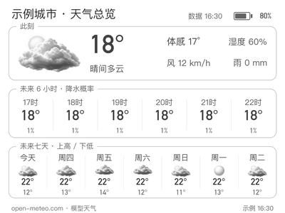

# NOTE4 十六灰天气 · 本地 SDK 应用

为 ZECTRIX NOTE4（400×300）制作的写实十六灰天气应用：天气首页、六小时与七日总览、实体按键翻页。




预览使用模拟天气和电量，不代表实时数据或实屏效果。

2026-10-22：更新日晴太阳图及映射，新增[晴天预览与更新说明](docs/ICON-UPDATE-2026-10-22.md)。沿用原B晴间多云的半写实插画方向；太阳的纹理和柔光仍待打磨，尚未通过用户视觉验收。

**安装的是电脑上的应用，通过官方 SDK 在 NOTE4 上显示和交互。** 当前公开 SDK 不提供向 NOTE4 安装 Python/Rust 应用包的接口；它需要电脑或 NAS 持续运行。无需改写固件，不占用旧云端五张墨卡槽位；主机休眠或程序退出会停止更新与交互。

## 环境准备

已验证环境为 Apple Silicon macOS；Linux 安装步骤已提供，未做 Linux 真机验证。Windows 暂无一键脚本，可参考上游 SDK 使用 Rust MSVC 和 C++ Build Tools 自行适配。

1. NOTE4 使用兼容官方固件 3.7.2；参阅 [官方升级文档](https://wiki.zectrix.com/zh/software/firmware) 和 [SDK 固件说明](vendor/zectrix-local-push-sdk/docs/FIRMWARE.md)。本项目不打包、不自动刷入固件。
2. 设备“设置 → 网络同步”开启“待机保持 Wi-Fi”；设备与主机同一局域网，允许 UDP 32342 和回复流量，访客 Wi-Fi/AP 隔离可能阻断通信。
3. Python 3.10+、Rust stable、C/C++ 工具链、CMake、curl。首次安装需联网。

macOS（已有 Homebrew）：

```sh
xcode-select --install
brew install python rust cmake
```

Ubuntu/Debian：

```sh
sudo apt-get update
sudo apt-get install python3 python3-venv python3-pip build-essential cmake pkg-config curl fonts-noto-cjk fonts-dejavu-core
```

Linux 另按 [Rust 官方方法](https://www.rust-lang.org/tools/install) 安装当前 stable，系统发行版旧版 Rust 可能不满足锁定依赖。

## 下载与安装

推荐使用以下命令。也可以点击 **Code → Download ZIP**，解压后进入项目目录，直接运行 `sh install.sh`。SDK 源码已内置，不需要子模块或另找私有文件。

```sh
git clone https://github.com/wuyinyuanye/note4-weather.git
cd note4-weather
sh install.sh
```

脚本建立 `.venv`、安装 Python 依赖、按 Cargo.lock 构建 Rust 桥，并在首次运行时创建 `config.json`，保留已有配置。遇到旧 Opus / CMake 兼容问题，脚本已设置 `CMAKE_POLICY_VERSION_MINIMUM=3.5`。

## 填写自己的设备与城市

编辑项目根目录 `config.json`：

```json
{
  "city": "南京",
  "latitude": 32.06167,
  "longitude": 118.77778,
  "target": "192.0.2.10",
  "expected_id": "YOUR_DEVICE_ID",
  "weather_interval_seconds": 3600
}
```

- `target` 填你的 NOTE4 局域网 IPv4，可加 `:32342`。`192.0.2.10` 为文档保留地址，不是真实设备。
- `expected_id` 填设备 SDK ID。先在路由器查到设备 IP，再运行下面的只读 INFO 工具，核对输出的设备名、画布和 ID 后抄入配置。工具不打开控制会话、不推图。
- `city` 是城市显示名，`latitude/longitude` 是该城市坐标；必须一起修改。本例南京为公开市中心坐标，不是 GPS。当前日期、农历、预报时区固定为中国标准时间 `Asia/Shanghai`，海外时区需调整代码。
- 刷新默认每小时，最小 60 秒。无需天气 API 密钥；请遵守天气服务使用条款。

```sh
python3 scripts/device_info.py YOUR_NOTE4_IPV4
```

Linux 字体默认寻找 Noto CJK 和 DejaVu；若路径不同：

```sh
export NOTE4_CLOCK_TEXT_FONT=/path/to/ChineseFont.ttc
export NOTE4_CLOCK_DIGIT_FONT=/path/to/DigitFont.ttf
```

## 启动、连接与退出

```sh
sh start.sh
```

打开 [本机控制页](http://127.0.0.1:18772/)，确认预览，再点击连接设备。启动默认不接管设备；配置正确且确实希望启动即连接时：

```sh
sh start.sh --connect
```

macOS 也可以双击 `start.command`。程序在终端前台运行，浏览器需自行打开。已经有应用占用 18772 时请使用已有控制页或先正常退出旧程序。不要同时启动多个设备客户端。

退出先点击断开，再在终端按 Ctrl+C；程序会关闭 SDK 会话。不后台自动重连，不自动安装开机任务。SSH 无图形环境可用 `ssh -L 18772:127.0.0.1:18772 user@host` 访问主机控制页；不要把管理端直接绑定到公网。

## 按键和页面

| 操作 | 功能 |
|---|---|
| 上/下短按、确认短按 | 首页与总览切换 |
| 长按上 | 回天气首页 |
| 长按下 | 进入天气总览 |

首页无时钟；日期、电池随正常页面更新显示。天气默认每 3600 秒取数，电量每分钟静默缓存，不因电池变化单独推图。相同图跳过提交。Gray16 使用连续灰度 PNG，由 SDK 按真实设备色板量化与抖色；当前固件十六灰使用全刷，不承诺无闪局刷。

取数失败保留同城市缓存，超过 90 分钟标陈旧、超过 6 小时不再显示旧数值。天气数据经取整与排版，来源 [Open-Meteo](https://open-meteo.com/)（[CC BY 4.0](https://creativecommons.org/licenses/by/4.0/)），非本地站点实测；免费接口使用范围以其 [服务条款](https://open-meteo.com/en/terms) 为准。

## 配置、隐私与卸载

`config.json` 被 Git 忽略。运行数据默认位于 `~/Library/Application Support/ZectrixNote4/weather-app/`（Linux 目前也使用此路径），包含天气缓存、日志、设备状态及显示记录。可用 `sh start.sh --data-dir /your/private/path` 自定义。对外分享只用源码包，勿打包运行数据目录。

本发布包不含原作者设备地址/ID、口令、令牌、原始交接记录、个人照片或历史 Git 数据。程序向 Open-Meteo 发送配置的城市坐标，不自动定位，不保存录音，不接入 ASR/TTS/大模型。控制服务仅监听本机 127.0.0.1。

卸载：正常退出应用，删除项目目录；如需删除私人缓存，再删除上述运行数据目录。设备固件无需还原。

## 提示词、架构与验证

- [完整开发提示词与素材生成提示词](docs/PROMPTS.md)：母版、公共风格、逐天气条件与编辑提示词。
- [第三方来源和许可](THIRD_PARTY_NOTICES.md)。
- 架构：Python 负责数据/页面/控制台，Rust 桥维持单个 SDK 连接与事件队列；最多一张图片在途，更新合并，录音时暂停推图。
- SDK 固定提交 `c71412f3f1e1d039bf4f09b9e7867c4661ae1237`，源码见 vendor，版本见 sdk-version.json。ResultUnknown 等错误需显式重试；不盲目重发或抢占忙碌设备。

```sh
.venv/bin/python -m unittest discover -s . -p 'test_*.py' -v
python3 scripts/check_release.py
python3 vendor/zectrix-local-push-sdk/scripts/verify.py
CMAKE_POLICY_VERSION_MINIMUM=3.5 cargo build --locked --manifest-path bridge/Cargo.toml
```

上述测试可离线验证逻辑与渲染，不连接真机。编译首次需下载依赖。显示成功以 SDK 的设备显示完成回执为准，实屏观感仍需现场观察。本发布包验证结果见 [VALIDATION.md](docs/VALIDATION.md)。
