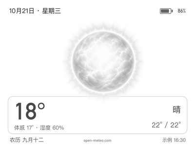
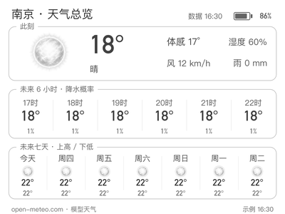

# 日晴图更新 · 2026-10-22

本次将日晴太阳换为原B风格的新图稿，添加整圈细短柔光与银灰明暗层次。首页、总览此刻、七日预报共享相同注册表。保留原B晴间多云及其他天气素材；没有修改天气代码、昼夜判定、取数周期、按键或SDK。

这些图是400×300连续灰度预览，温度、电量、日期与预报均为模拟数据；设备由SDK转换Gray16，不使用预抖色图。图稿的表面纹理与柔光仍待打磨，未通过用户视觉验收。

原始素材：`assets/weather-realistic-v1/clear-day-illustrated-v7.png`。manifest版本7对应开发图稿编号，不表示已经发布七个稳定应用版本。旧`clear-day.png`保留但当前未引用，可恢复该文件、原哈希并移除hero_box回退。

本次更新不会复制原作者的设备配置、运行数据、私人照片或内部交接记录。
